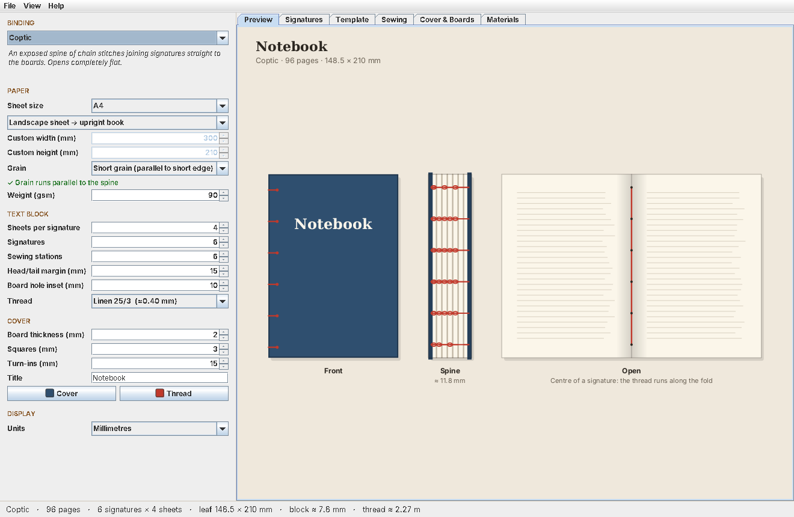
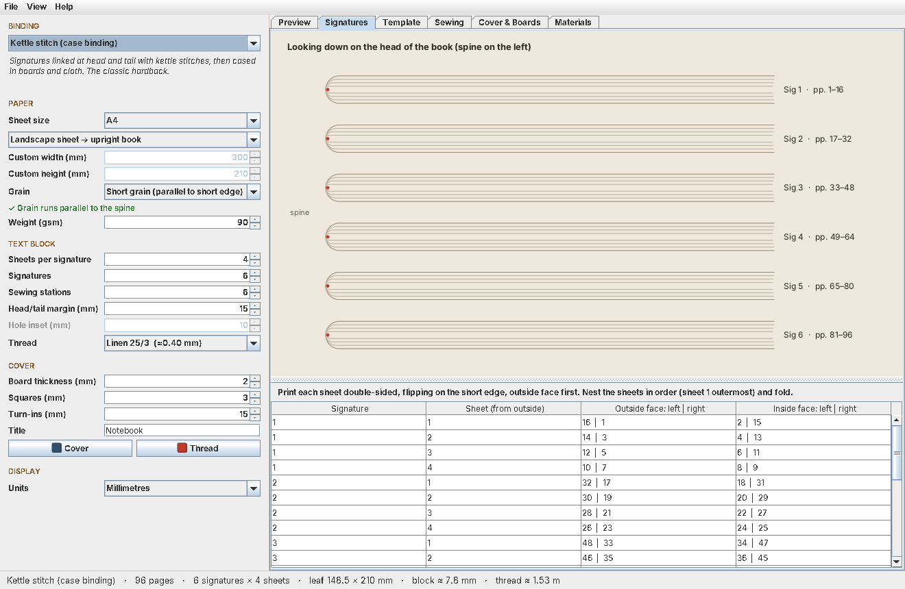
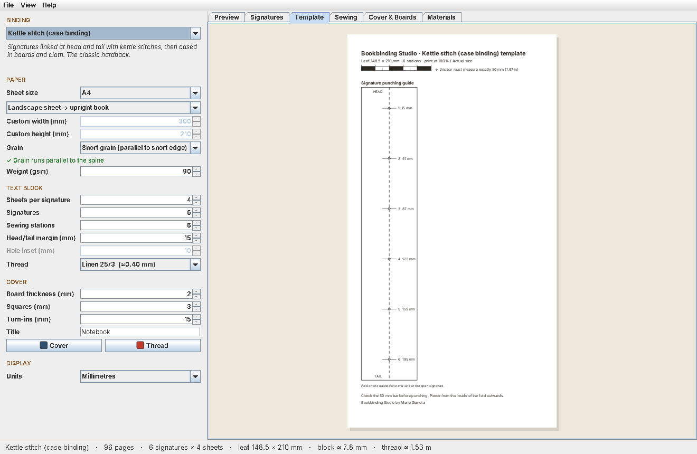
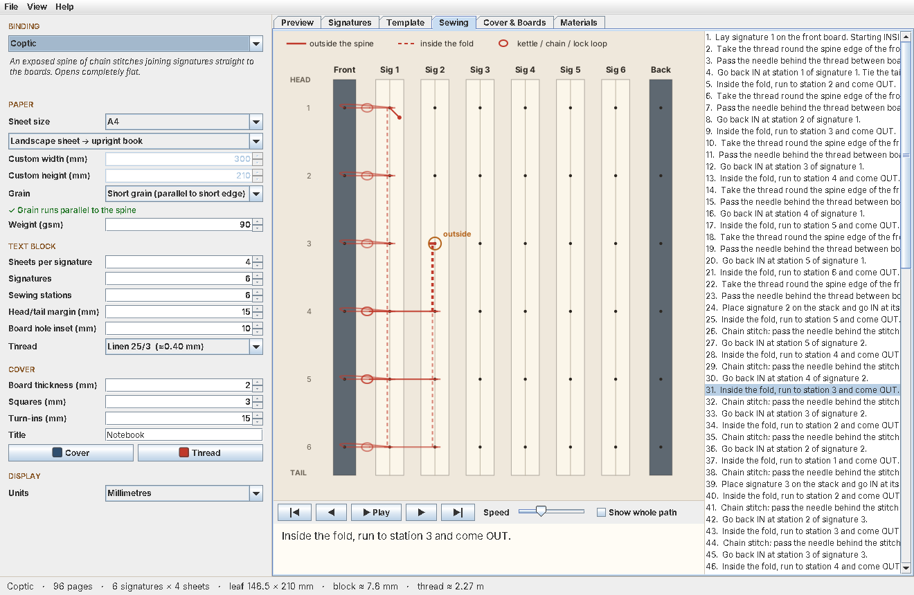
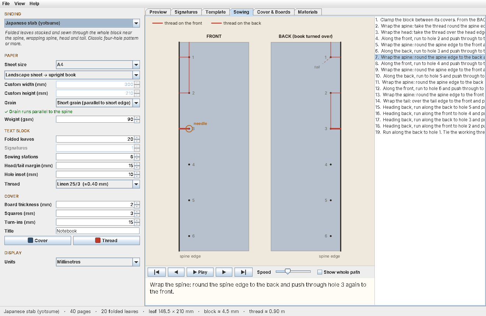
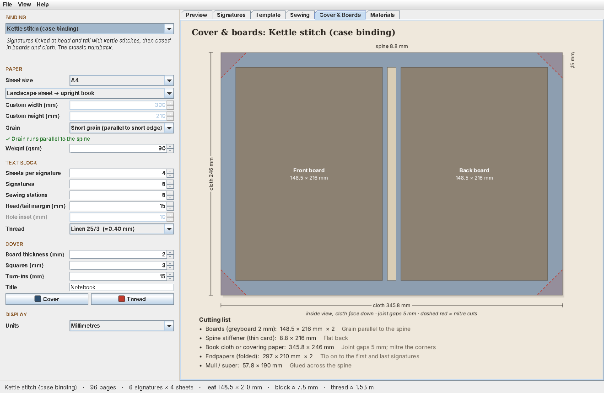

# Bookbinding Studio

**Design a hand-bound book, then take everything you need to the bench.**

Bookbinding Studio is a desktop app for people who make books by hand. Describe the book you want: its paper, size, number of signatures and binding style. The app then gives you a true-scale punching template, an animated step-by-step sewing diagram, the length of thread to cut, the sizes to cut the boards and cover to, and a page-order map for printing your own text block.

It's a single Java file with no dependencies.



---

## Bindings

| Binding | What it is | Good for |
|---|---|---|
| **Pamphlet stitch** (3, 5 or 7 holes) | One signature sewn through its fold and cover | Zines, booklets, slim notebooks: a first binding |
| **Kettle stitch** (case binding) | Signatures linked at head and tail with kettle stitches, then cased in boards and cloth | The classic hardback |
| **Long-stitch** | Signatures sewn straight through a soft cover spine, so the stitching becomes the decoration | Journals, leather or card covers, no glue |
| **Coptic** | An exposed spine of chain stitches joining the signatures directly to the boards | Sketchbooks that need to open completely flat |
| **Japanese stab** (yotsume family, 3–8 holes) | Folded leaves stacked and sewn through the whole block, wrapping the spine, head and tail | Single sheets, photo albums, prints |

---

## Quick start

You need **Java 17 or later**. On macOS, Windows or Linux:

```bash
java BookbindingStudio.java
```

That's it: Java's source launcher compiles and runs the file in one step. If you'd rather compile first:

```bash
javac BookbindingStudio.java
java BookbindingStudio
```

---

## The tabs

### Preview
The finished book drawn three ways: the front cover, the spine and the book lying open. Each binding's spine is drawn from its actual sewing path, so Coptic shows its chains and long-stitch shows its columns of stitches. Choose your own cover and thread colours and a title.

### Signatures
A view looking down on the head of the book, showing how the sheets nest into signatures, with page ranges. Below it is a **page-imposition table** saying which page numbers go on which side of every sheet, along with the correct duplex setting ("flip on the short edge"). This is what you need if you're printing your own text block.



### Template
A punching guide drawn at **true scale**, ready to print:

- **Signature guide:** fold it on the dashed line, sit it in the open signature and pierce at each mark.
- **Board drilling guide** for Coptic.
- **Hole guide** for stab binding, aligned to the spine edge.
- **Cover spine guide** for long-stitch, with one column of holes per signature.

Every template carries a **50 mm calibration bar**. Measure it before you punch. If it isn't exactly 50 mm, reprint at 100% / Actual size. Templates taller than the printable page are split across several pages with a 10 mm overlap.



### Sewing
The heart of the app. The spine is drawn face-on with every signature and sewing station, and the thread path builds up one step at a time with a plain-English instruction for each step:

> *Kettle stitch: slip the needle between signatures 2 and 3, behind the thread linking them at station 6, then pass it up through the loop you've just formed. Snug it down.*

- **Solid lines** run outside the spine and **dashed lines** run inside the fold. Loops mark kettle, chain and lock stitches.
- Step with **◀ ▶** or the arrow keys, or press **Play** and set the speed.
- Click any step in the list to jump straight to it.
- **Show whole path** draws the complete sewing at once.
- A running total shows how much thread you've used so far.



Stab binding has its own view, showing the front and back of the book side by side, so you can follow the thread as it passes through the block and wraps the spine.



### Cover & Boards
Cutting diagrams with dimensions for the binding you've chosen:

| Binding | Diagram |
|---|---|
| Case binding | Book cloth with front board, spine stiffener and back board laid out, joint gaps, turn-ins and mitre cuts |
| Coptic | Two covered boards with mitred corners and the hole positions |
| Long-stitch | The limp cover with fore-edge flaps, fold lines and the spine hole grid |
| Pamphlet and stab | Simple cover sheets with their holes |

A cutting list underneath gives every piece and how many to cut.



### Materials
A bench list you can work from:

- the number of sheets of paper
- block thickness
- a grain check
- how much thread to cut, compared with the traditional rule of thumb
- the cover pieces
- the tools you'll need
- the order of work

---

## How it works

### Paper and grain
Each sheet is folded once, parallel to its height, so an A4 sheet held landscape gives an A5 leaf. Paper caliper is estimated from its weight (about 0.1 mm at 80 gsm). Block thickness adds the swell from the thread in each fold.

Paper folds and lies flat best when its grain runs **parallel to the spine**. The app works out which grain your sheet orientation needs and warns you if you've chosen the wrong one.

### Sewing paths
Each binding style generates its sewing as a list of steps. Each step records:

- where the needle is: signature or board, and station
- which side of the paper it ends up on
- what it's doing: passing through, linking to a board, kettle, chain, wrap, tie
- how much thread it uses

One shared renderer animates any step list, so adding a new binding only means writing a new step generator.

The paths are built so that every stitch is sewn exactly once and the thread ends where its tail is, ready to tie off.

### Thread length
The thread length isn't a guess or a single rule of thumb. It's the **sum of every step in the actual sewing path**:

- runs along the fold between stations
- passes through the holes
- moves between signatures
- links, kettle stitches and chains
- wraps around the spine and the head and tail

The app adds 10% working slack and two 8 cm tails to that total. The Materials tab also shows the traditional rule of thumb where one exists, so you can compare the two. For a 96-page A5 kettle-stitch book, the path gives 1.53 m and the rule of thumb gives 1.47 m.

If the thread runs past about 2 m, the app suggests sewing with shorter lengths joined by a weaver's knot.

---

## Files

- **File → Save / Open** stores a book design as a small `.bind` text file (Java properties format).
- **File → Export current tab as PNG** saves whichever view you're looking at, at double resolution.
- **File → Print punching template** prints the template at true scale.

All measurements are entered in millimetres. **Units → Inches** switches how the results are displayed.

---

## A note on accuracy

Thread lengths, spine thickness and cover sizes are **bench estimates**. Paper caliper varies between makers, thread swells differently depending on tension, and the joint gap and board set-back on a case binding are traditional rules of thumb, not physics. Check the numbers against your own materials before cutting good cloth or leather. Cutting a test piece first never hurts.

---

## Possible future additions

- More stab patterns: Kikko (tortoiseshell), Asa-no-ha (hemp leaf) and Koki
- French link stitch and sewing on tapes
- Rounded and backed spines for case binding
- Headbands and a spine-lettering layout

---

## Author

**Mario Gianota**
Copyright 2026. All Rights Reserved.
